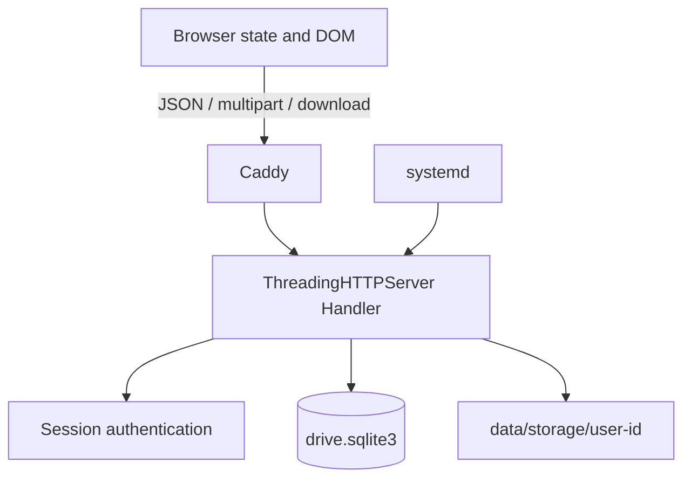
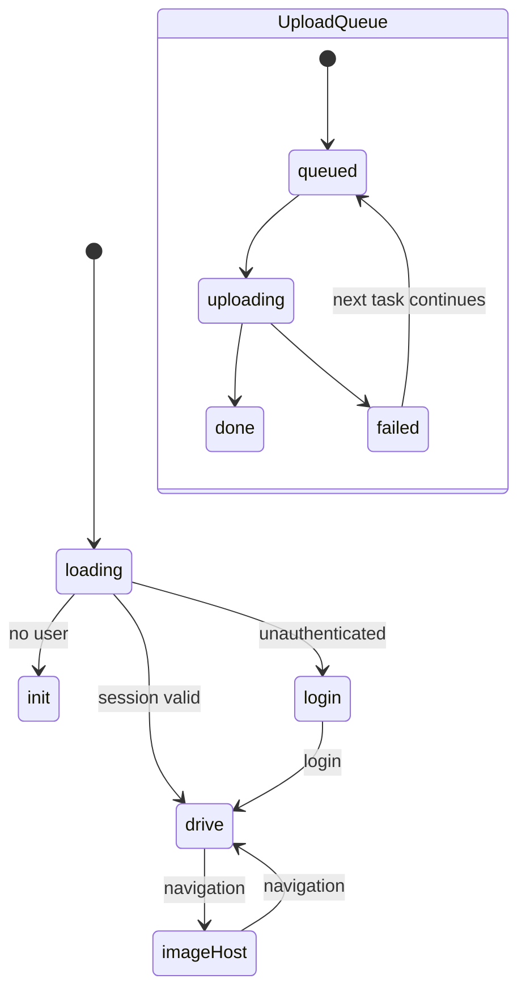
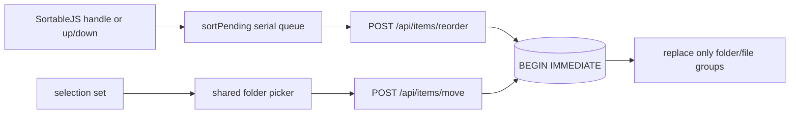

# 架构

## 总体结构

R2 Drive 是单进程应用。`app.py` 同时包含 HTML/CSS/JavaScript、HTTP 路由、业务逻辑、SQLite 初始化和进程入口。

### 请求分层

1. Caddy 终止 TLS，转发至 `127.0.0.1:8090`。
2. `Handler.route()` 将 `/api/`、`/public/`、`/share/` 和前端 shell 分流。
3. 私有 API 通过 `require_auth()` 读取 Cookie、哈希 Token 并关联用户。
4. 数据库查询同时约束 `user_id` 和分类；磁盘只按已查到的 `storage_path` 读写。
5. DTO 把数据库 snake_case 字段转换为前端 camelCase。

## 并发和事务

`ThreadingHTTPServer` 为请求创建线程。每次 `db()` 打开短生命周期 SQLite 连接，设置 15 秒 busy timeout；初始化启用 WAL。首次管理员初始化使用 `BEGIN IMMEDIATE`，防止并发创建多个管理员。应用没有跨请求工作队列或分布式锁，不适合跨节点共享同一数据库。

## 前端状态

全局对象 `S` 保存当前视图、目录、列表、搜索、Modal、选择集、上传队列和排序 Promise 链。页面级 `render()` 仍用于视图切换和结构变化；上传进度、Toast、选择、排序和移动完成刷新使用局部 DOM。

上传队列不属于 `drive` 或 `imageHost` 页面生命周期，切换页面不会取消 XHR 或改变已入队任务的目标目录。详见 [UPLOAD_PIPELINE.md](UPLOAD_PIPELINE.md)。

## 排序和移动数据流

桌面文件夹和文件是两个 Sortable 容器；移动端不用触摸拖排。排序保存严格串行，避免拖拽后立即点击按钮时按旧数组计算。移动选择器只展示目录，后端仍重新验证用户、分类、后代关系和冲突。逻辑移动不触碰 `storage_path`。

## 数据和存储

SQLite 保存用户、会话、目录、文件元数据、分享状态和统计。文件实体保存在 `storage/<user-id>/<file-id>-<safe-name>`。数据库没有声明外键；应用通过查询和非空目录检查维护逻辑关系。备份必须同时覆盖数据库和 `storage/`。

## 部署边界

- systemd 以 `r2-drive` 用户执行 `.venv/bin/python app.py`。
- `ProtectSystem=strict`，仅 `/opt/r2-drive/data` 可写。
- Caddy 主配置通过 import 引用独立站点片段。
- TLS、ACME 和其他站点属于 Caddy 全局基础设施，不属于 R2 Drive 清理范围。

进一步阅读：[前端](architecture/frontend.md)、[后端](architecture/backend.md)、[认证](architecture/authentication.md)、[数据库](DATABASE.md)。
