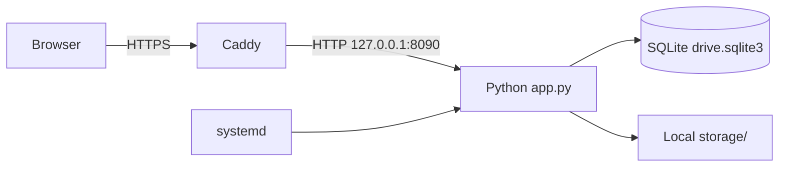

# 项目概况

## 定位

R2 Drive 是供单一所有者部署在一台 Debian 服务器上的私人网盘和图床。它适合个人文件、软件包和图片分发；不面向企业多租户、对象存储集群、在线协作编辑、内容审计、配额计费或高并发 CDN。

## 技术栈

- 浏览器：原生 HTML/CSS/JavaScript，内嵌于 `app.py`
- 服务端：Python `ThreadingHTTPServer` / `BaseHTTPRequestHandler`
- 上传解析：`python-multipart>=0.0.20,<0.1`
- 元数据：SQLite，运行时启用 WAL 和 15 秒 busy timeout
- 文件实体：本地文件系统 `data/storage/<user-id>/`
- 入口：Caddy 自动 HTTPS 和反向代理
- 守护：systemd，专用 `r2-drive` 用户和受限写目录

项目没有编译或打包步骤。源码 checkout 本身就是应用；部署时创建虚拟环境并安装 `requirements.txt`。

## 运行边界

应用默认只监听回环地址。Caddy 负责 TLS 和 `X-Forwarded-Proto`，后者决定登录 Cookie 是否带 `Secure`。

## 核心边界

- 单用户界面，但 schema 保留 `user_id`；不要据此假设已有完整多用户产品能力。
- SQLite 只保存元数据，文件内容不存入数据库。
- `drive` 与 `image_host` 共用表和存储，但所有查询必须分类隔离。
- 分享 Token 是外部稳定标识，数据库 ID 和磁盘路径是持久标识。
- 搜索是浏览器对已加载当前目录数据的过滤，不是服务器端全文搜索。

## 非目标

- 不提供分片、断点续传或并行上传协议。
- 不提供对象存储适配、去重、缩略图服务、病毒扫描或内容转码。
- 不提供数据库外键级联；生命周期由应用显式管理。
- 不保证高并发或跨节点一致性。
- 不维护 React/Vue 构建链或 Uppy Dashboard 运行依赖。
